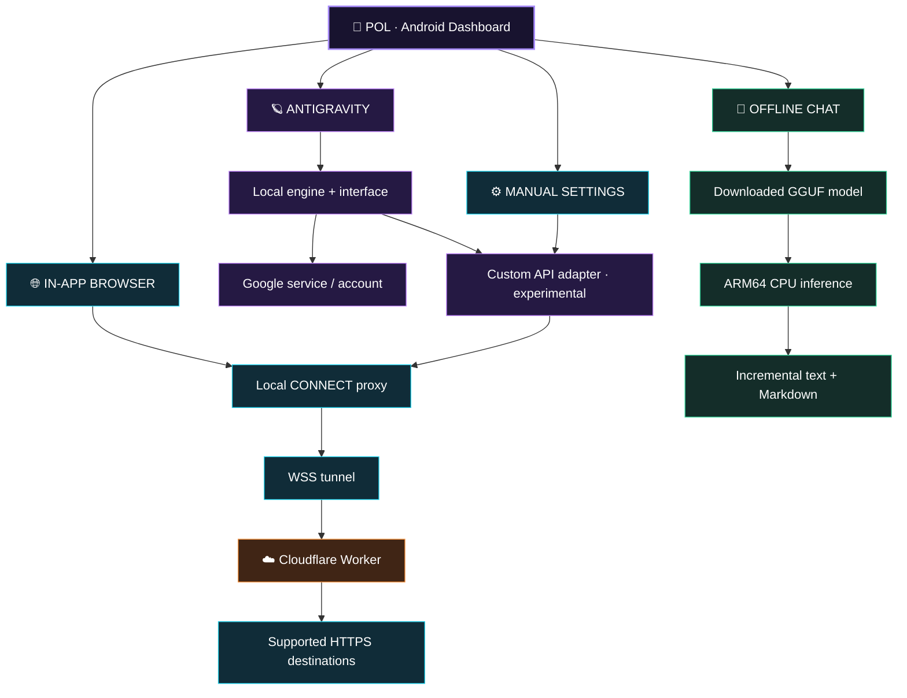

<div align="center">


# 🌌 Pol Cloudflare Bridge

### Antigravity, offline models and a cloud bridge — together on Android

**One dashboard · Multiple AI paths · Your choice**

<br/>

<a href="https://github.com/imgutss/pol-cloudflare-bridge/releases/download/1.0.2/Pol-Cloudflare-Bridge-1.0.2.apk"></a>
<a href="./README_FA.md"></a>
<a href="https://github.com/imgutss/pol-cloudflare-bridge/stargazers"></a>

<br/><br/>


<br/>

[🚀 Quick start](#quick-start) · [🪐 Antigravity](#antigravity) · [🌳 Architecture](#architecture) · [🧠 Offline](#offline) · [📦 Download](#download)

</div>

---

## ✨ Four experiences, one dashboard

| 🪐 Antigravity | 🌐 Gemini & Muse | 🧠 Offline | ☁️ Cloudflare bridge |
| :---: | :---: | :---: | :---: |
| On-device environment & engine | In-app service browser | Text models on CPU | Configurable connection |
| Choose a model and chat | Gemini keyboard handling | Progressive output & Markdown | No separate server required |

> **Pol is an independent client, not an official Google or Cloudflare product.** Service access and capabilities depend on your account, model, permissions and service conditions.

---

<a id="antigravity"></a>

## 🪐 Antigravity — the centerpiece

Antigravity is more than a dashboard shortcut. Pol opens an **on-device environment and engine** where you can sign in if needed, select an available model and continue a conversation. The app's browser and offline chat remain separate paths.

| 🎛️ Model control | 🔌 Custom API model |
| :--- | :--- |
| Sign in with Google when required | Manually enter **URL, model name and API key** |
| Choose a model next to the chat box | OpenAI-compatible custom API path |
| Persian / English interface option | Uses the configured bridge for the custom path |
| Available tools depend on the account and service | Start a new conversation after changing settings |

> **Release 1.0.2 security notice:** This APK contains a bridge access credential that can be extracted. Treat the bridge credential as exposed; the bridge operator can see API keys and prompts. Use only a low-risk key and avoid confidential data.
>
> Compatibility is not universal: image-only Qwen models are not supported as chat models; Fable may still report insufficient quota. Artifact downloads are experimental, with a 32 MiB limit for the supported blob/data path. The APK internal version name remains `1.0.1` (version code 38).

**Important:** custom API integration is experimental and configured for one text model; it does not imply support for every provider or model. Tool calls, images and audio are not guaranteed across APIs. Approve file and terminal permissions only when you trust the request. Login and some native paths may use different network behavior.

<details>
<summary><b>🚀 Open Antigravity in three steps</b></summary>

1. On the dashboard, select **Antigravity** and tap Open.
2. On first launch, wait for the engine files to initialize and sign in to Google if requested.
3. Pick a model available to your account next to the message box. For a custom API, enter the URL, model name and key, then start a new conversation.

</details>

---

<a id="architecture"></a>

## 🌳 Branching architecture

Four paths begin at the same dashboard, but they do not all share the same network route:



<sub>This is a simplified map: not every native path or provider has been verified to use the tunnel. The Google path can vary with configuration. The custom adapter does not fall back to a direct connection when its bridge is unavailable.</sub>

### 🔀 Branch map at a glance

```text
Pol
├── 🪐 Antigravity
│   ├── On-device engine and interface
│   ├── Google account and available models
│   └── Experimental custom API → local bridge → Cloudflare → service
├── 🌐 In-app browser → local bridge → Cloudflare → destination
├── 🧠 Offline chat → downloaded model → device CPU
└── ⚙️ Manual settings → URL + model name + API key
```

---

<a id="offline"></a>

## 🧠 Offline AI

After downloading a compatible model, text conversations can run without an internet connection:

| Capability | 1.0.2 experience |
| :--- | :--- |
| 📦 **Models** | Separate downloads, horizontal cards and a delete option |
| 💬 **Live response** | Incremental text instead of waiting for the entire reply |
| ⚡ **Model retention** | The loaded model stays in memory between messages |
| 📝 **Markdown** | Formatted text, lists and code |
| 🖥️ **Execution** | Text inference on the device's ARM64 CPU |

Models are not bundled in the APK. File size, memory use and speed vary by model and device. **Offline image/camera input and GPU acceleration are not included in this release.**

---

## ⌨️ Gemini & online experience

- Open Gemini and Muse in the app's internal browser.
- Updated Gemini keyboard inset handling, confirmed by a user on a device.
- Enter custom-service details manually instead of relying on automatic model discovery.
- Configure an existing Cloudflare Worker bridge from the app.

Access, account features, speed and regional restrictions depend on the service and network. **A specific outbound country or US IP is not guaranteed.**

---

<a id="quick-start"></a>

## 🚀 Quick start

**1. Install** — Download and install the [1.0.2 APK](https://github.com/imgutss/pol-cloudflare-bridge/releases/download/1.0.2/Pol-Cloudflare-Bridge-1.0.2.apk).

**2. Choose a path** — Open Antigravity from its card, or go to Offline AI and download a compatible model.

**3. Configure the bridge** — If you use your own Cloudflare Worker, enter its URL and bridge key in Settings. Worker files and setup are in [`worker/`](./worker/).

**4. Configure a custom API** — In Antigravity settings, manually enter your service URL, model name and API key, then start a new conversation.

<a id="download"></a>

## 📦 Download & installation

| Version | Size | Requirements | Get it |
| :---: | :---: | :---: | :---: |
| **1.0.2** | ~**168 MB** | Android 8+; offline: ARM64 and sufficient memory | [⬇️ Download APK](https://github.com/imgutss/pol-cloudflare-bridge/releases/download/1.0.2/Pol-Cloudflare-Bridge-1.0.2.apk) |

> Back up important data before installing. Android may reject an in-place update if the installed APK uses a different signing key; uninstalling can erase app data.

<details>
<summary><b>🔍 File details and source status</b></summary>

- SHA-256: `989811fbe2600ada94eeb216f91d30696ddf6620f90da9c8456447d55a34ebd9`
- Existing custom-model output cap is 8192 tokens, with a 4096 fallback if provider metadata is absent.
- The Gemini keyboard was confirmed by a user on a device; not all devices and WebView versions have been tested.
- The repository contains earlier sources and [selected patches](./android/patches/v1.0.1/); the **complete source and an independent reproducible APK build are not currently available**.
- Bundled components and separately downloaded models may have their own license terms.

</details>

---

<div align="center">

### 🌌 One bridge. More ways to explore.

[📦 Releases](https://github.com/imgutss/pol-cloudflare-bridge/releases) · [📋 Changelog](./CHANGELOG.md) · [🔒 Security](./SECURITY.md) · [🤝 Contributing](./CONTRIBUTING.md)

**Built by [Guts · imgutss](https://github.com/imgutss)**

</div>
