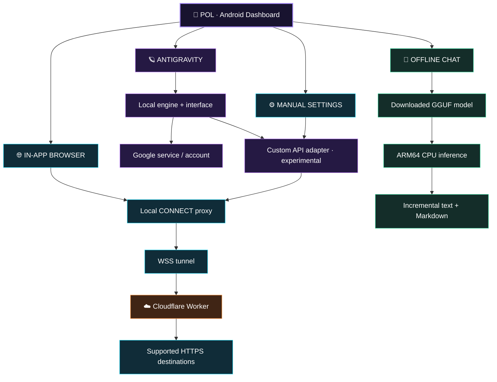

<div align="center">


# 🌌 Pol Cloudflare Bridge

### آنتی‌گرویتی، مدل‌های آفلاین و پل ابری؛ کنار هم، روی اندروید

**یک داشبورد · چند مسیر هوش مصنوعی · انتخاب با تو**

<br/>

<a href="https://github.com/imgutss/pol-cloudflare-bridge/releases/download/v1.0.1/Pol-Cloudflare-Bridge.apk"></a>
<a href="./README.md"></a>
<a href="https://github.com/imgutss/pol-cloudflare-bridge/stargazers"></a>

<br/><br/>


<br/>

[🚀 شروع سریع](#quick-start) · [🪐 آنتی‌گرویتی](#antigravity) · [🌳 معماری](#architecture) · [🧠 آفلاین](#offline) · [📦 دانلود](#download)

</div>

---

## ✨ یک نگاه، چهار دنیا

| 🪐 Antigravity | 🌐 Gemini و Muse | 🧠 آفلاین | ☁️ پل Cloudflare |
| :---: | :---: | :---: | :---: |
| محیط و موتور روی گوشی | مرورگر داخلی سرویس‌ها | مدل متنی روی CPU | اتصال قابل تنظیم |
| انتخاب مدل و گفت‌وگو در محیط | اصلاح کیبورد Gemini | پاسخ تدریجی و Markdown | بدون سرور جداگانه |

> **Pol یک کلاینت مستقل است، نه محصول رسمی Google یا Cloudflare.** دسترسی و قابلیت‌های هر سرویس به حساب، مدل، مجوزها و شرایط سرویس وابسته‌اند.

---

<a id="antigravity"></a>

## 🪐 آنتی‌گرویتی — قلب تجربه

آنتی‌گرویتی فقط یک لینک روی داشبورد نیست؛ در Pol یک **محیط و موتور محلی روی گوشی** باز می‌شود تا بتوانی در همان محیط، حساب و مدل را انتخاب کنی و گفت‌وگو را ادامه بدهی. بخش آنلاین و آفلاین برنامه مسیرهای مستقل خودشان را دارند.

| 🎛️ مرکز کنترل مدل | 🔌 مدل API سفارشی |
| :--- | :--- |
| ورود به حساب Google در صورت نیاز | تنظیم دستی **URL، نام مدل و API Key** |
| انتخاب مدل کنار کادر گفت‌وگو | مسیر API سفارشی OpenAI-compatible |
| رابط فارسی / English در محیط | اتصال به پل موجود برای این مسیر |
| ابزارهای موجود وابسته به حساب و سرویس | بعد از تغییر تنظیمات، یک گفت‌وگوی جدید بساز |

**مهم:** اتصال مدل سفارشی آزمایشی و برای یک مدل متنی است و به معنی سازگاری همهٔ ارائه‌دهندگان یا همهٔ مدل‌ها نیست. ابزارها، تصویر، صدا و فراخوانی ابزار با هر API تضمین نشده‌اند. هنگام استفاده از فایل یا ترمینال، فقط مجوزهای مورد اعتماد را تأیید کن. ورود و بعضی مسیرهای بومی ممکن است رفتار شبکهٔ متفاوتی داشته باشند.

<details>
<summary><b>🚀 ورود به Antigravity در سه قدم</b></summary>

1. در صفحهٔ اصلی، کارت **Antigravity** و سپس «باز کردن» را بزن.
2. در اولین اجرا، برای آماده‌شدن فایل‌های موتور صبر کن و اگر درخواست شد وارد حساب Google شو.
3. از کنار کادر پیام، مدل موجود در حسابت را انتخاب کن. برای API سفارشی، ابتدا تنظیمات URL، نام مدل و کلید را وارد کن و گفت‌وگوی جدید بساز.

</details>

---

<a id="architecture"></a>

## 🌳 معماری شاخه‌ای

چهار مسیر اصلی از یک داشبورد شروع می‌شوند، اما همهٔ آن‌ها یک مسیر شبکهٔ یکسان ندارند:



<sub>این نمودار مسیرهای اصلی را ساده‌سازی می‌کند: تمام مسیرهای بومی یا ارائه‌دهندگان از نظر عبور از تونل تأیید نشده‌اند. مسیر Google بسته به تنظیمات می‌تواند متفاوت باشد. اتصال مستقیم برای adapter سفارشی در صورت نبود پل جایگزین نمی‌شود.</sub>

### 🔀 نقشهٔ شاخه‌ها در یک نگاه

```text
Pol
├── 🪐 Antigravity
│   ├── موتور و رابط روی گوشی
│   ├── حساب Google و مدل‌های قابل‌دسترسی حساب
│   └── API سفارشی آزمایشی → پل محلی → Cloudflare → سرویس
├── 🌐 مرورگر داخلی → پل محلی → Cloudflare → مقصد
├── 🧠 گفت‌وگوی آفلاین → مدل دانلودشده → CPU گوشی
└── ⚙️ تنظیمات دستی → URL + نام مدل + کلید API
```

---

<a id="offline"></a>

## 🧠 هوش مصنوعی آفلاین

بدون نیاز به اینترنت در زمان گفت‌وگو، پس از دانلود مدل سازگار:

| قابلیت | تجربه در v1.0.1 |
| :--- | :--- |
| 📦 **مدل‌ها** | دانلود جداگانه، کارت‌های افقی و امکان حذف مدل |
| 💬 **پاسخ زنده** | نمایش تدریجی متن به جای انتظار برای پاسخ کامل |
| ⚡ **نگه‌داشت مدل** | مدل بارگذاری‌شده بین پیام‌ها در حافظه نگه داشته می‌شود |
| 📝 **Markdown** | نمایش قالب‌بندی متن، فهرست‌ها و کد |
| 🖥️ **اجرا** | پردازش متنی روی CPU دستگاه ARM64 |

مدل‌ها داخل APK نیستند؛ حجم فایل، حافظهٔ لازم و سرعت اجرا به مدل و دستگاه بستگی دارند. **عکس و دوربین آفلاین و شتاب GPU در این نسخه وجود ندارند.**

---

## ⌨️ Gemini و تجربهٔ آنلاین

- باز کردن Gemini و Muse در مرورگر داخلی برنامه.
- اصلاح مدیریت فضای کیبورد Gemini؛ نسخهٔ جدید توسط کاربر روی دستگاه بررسی شده است.
- ورود دستی مشخصات سرویس سفارشی به‌جای کشف یا انتخاب خودکار مدل.
- امکان استفاده از ورکر Cloudflare موجود در تنظیمات برنامه.

دسترسی به سرویس‌ها، امکانات حساب، سرعت و محدودیت‌های منطقه‌ای به شرایط سرویس و شبکه وابسته‌اند؛ **خروجی ثابت آمریکا یا کشور مشخص تضمین نمی‌شود.**

---

<a id="quick-start"></a>

## 🚀 شروع سریع

**۱. نصب** — [APK نسخهٔ 1.0.1](https://github.com/imgutss/pol-cloudflare-bridge/releases/download/v1.0.1/Pol-Cloudflare-Bridge.apk) را دانلود و نصب کن.

**۲. انتخاب مسیر** — برای Antigravity کارت آن را باز کن؛ برای گفت‌وگوی محلی به بخش آفلاین برو و مدل مورد نظرت را دانلود کن.

**۳. تنظیم پل** — اگر از Cloudflare Worker خودت استفاده می‌کنی، آدرس و کلید پل را در تنظیمات وارد کن. دستورها و فایل‌های ورکر در [`worker/`](./worker/) قرار دارند.

**۴. اتصال API سفارشی** — در تنظیمات Antigravity، آدرس سرویس، نام مدل و کلید API را دستی وارد کن؛ بعد گفت‌وگوی جدید بساز.

<a id="download"></a>

## 📦 دانلود و نصب

| نسخه | حجم | پیش‌نیاز | دریافت |
| :---: | :---: | :---: | :---: |
| **v1.0.1** | حدود **۱۶۸ مگابایت** | Android 8+؛ آفلاین: ARM64 و حافظهٔ کافی | [⬇️ دانلود APK](https://github.com/imgutss/pol-cloudflare-bridge/releases/download/v1.0.1/Pol-Cloudflare-Bridge.apk) |

> پیش از نصب از داده‌های مهم پشتیبان بگیر. اگر نسخهٔ نصب‌شده امضای متفاوتی داشته باشد، نصب روی نسخهٔ قبلی ممکن است پذیرفته نشود؛ حذف برنامه می‌تواند داده‌های آن را پاک کند.

<details>
<summary><b>🔍 جزئیات فایل و وضعیت سورس</b></summary>

- SHA-256: `4416f0fae025d471936bef2a639485040f1ce67d6ef5deb4cf294cfce36e86fe`
- کیبورد Gemini در یک دستگاه توسط کاربر تأیید شده؛ همهٔ دستگاه‌ها و نسخه‌های WebView آزمایش نشده‌اند.
- مخزن شامل منابع نسخه‌های قبلی و [قطعات منتخب تغییرات](./android/patches/v1.0.1/) است؛ **سورس کامل و فرایند بازتولید مستقل APK فعلاً موجود نیست**.
- اجزای همراه و مدل‌های جداگانه ممکن است شرایط مجوز خودشان را داشته باشند.

</details>

---

<div align="center">

### 🌌 یک پل برای کشف مسیرهای بیشتر

[📦 انتشارها](https://github.com/imgutss/pol-cloudflare-bridge/releases) · [📋 تاریخچه تغییرات](./CHANGELOG.md) · [🔒 امنیت](./SECURITY.md) · [🤝 مشارکت](./CONTRIBUTING.md)

**ساخته‌شده توسط [Guts · imgutss](https://github.com/imgutss)**

</div>
